# Architecture

## Pipeline

```mermaid
flowchart LR
    T[/"Résumé text (.txt)"/] --> E

    subgraph S1["1 · Extraction — regular expressions"]
        E["ResumeExtractor<br/>re module"]
    end
    E -- "ExtractionResult<br/>JS, React.js, NodeJS..." --> P

    subgraph S2["2 · Normalization — finite-state transducers"]
        P["M_pre<br/>lower case, delete separators"] --> C["M_category<br/>trie + end mark $"]
        C --> O["sort_for_profile<br/>canonical order"]
    end
    O -- "one sorted sequence per profile<br/>JAVASCRIPT REACT NODE_JS..." --> A

    subgraph S3["3 · Classification — finite automata"]
        A["4 automata (pyformlang)<br/>DFA · NFA · ε-NFA · ε-NFA"]
    end
    A -- "ACCEPTED / REJECTED" --> G

    subgraph S4["4 · Candidate profile language — CFG (textX)"]
        G["generate_dsl"] --> V["parse_dsl<br/>grammar + object processors"]
        V -- valid model --> H["render_html"]
        V -- error --> X["ResumeValidationError<br/>lexical / syntax / semantic"]
    end
    H --> R[/"HTML report"/]
```



## Folder structure

```text
resumelens/
├── src/resumelens/
│   ├── models.py              data classes shared by the stages
│   ├── pipeline.py            runs the four stages
│   ├── docs_export.py         writes 7-tuples, 5-tuples and diagrams into docs/diagrams
│   ├── __main__.py            python -m resumelens
│   ├── extraction/            stage 1: patterns.py, extractor.py
│   ├── normalization/         stage 2: variants.py, transducers.py, normalizer.py, sorter.py
│   ├── classification/        stage 3: profiles.py, automata.py, classifier.py
│   ├── profiles/              the four profile definitions (JSON)
│   ├── dsl/                   stage 4: resume.tx, parser.py, generator.py, visualizer.py
│   └── ui/                    cli.py
├── data/
│   ├── sample_resumes/        input examples
│   └── output/                generated JSON, DSL and HTML
├── docs/                      design documents (this folder)
└── tests/                     pytest suites, one per stage + CLI + end to end
```

## Design decisions

| Decision | Reason |
|---|---|
| **One pipeline for the four profiles** | The profiles are data (JSON files), and the transducers, the sorter, the automaton builder and the grammar are shared. Adding a fifth profile means writing one JSON file, not new code. |
| **Each stage only knows the previous one** | Extraction does not know about tokens, transducers do not know about profiles, automata do not know about text. Each formal model does exactly one job, as the assignment separates them. |
| **Category-aware normalization** | Stage 1 already classifies a string as a language, framework, etc. Stage 2 uses that to pick a small transducer instead of one huge one. |
| **Sorting before classification** | It turns "contains these groups in any order" (exponential number of states) into "these groups in this order" (a chain of n+1 states). |
| **Alphabet of the automata = canonical tokens** | The automata reason about qualifications, not characters, and they stay small and readable. |
| **Three automaton types** | DFA when the pattern is a plain sequence, NFA to show the G\*G formulation of "one or more", ε-NFA when a group is optional. |
| **Validate the DSL even though we generate it** | The DSL is a language of its own and can be written by hand. The HTML is produced only from a model that passed the grammar. |
| **Formal definitions are generated from the code** | `docs_export.py` reads the pyformlang objects, so the documented tuples and the implementation can't disagree. |
| **Simple, explicit Python** | Plain classes and loops, so each step of the models can be followed and explained in the presentation. |

## External libraries

| Library | Used for |
|---|---|
| `re` (standard library) | regular expressions, stage 1 |
| `pyformlang` 1.0.11 | `FST` (stage 2), `DeterministicFiniteAutomaton`, `NondeterministicFiniteAutomaton`, `EpsilonNFA` (stage 3) |
| `textX` ≥ 4.0 | grammar, parser and object processors (stage 4) |
| `pytest` | tests |

## Limits of the design

- Extraction only sees **explicit** mentions. "Five years building React apps" is found, but "frontend expert" says nothing to the system.
- Variants that are not in `variants.py` are rejected by the transducers (shown as *unknown*, never guessed).
- A profile pattern says *which* qualifications must be present, not *how good* the candidate is. ResumeLens does not rank or hire. It only reports whether the formal pattern is satisfied.
- Only plain-text résumés are read. PDF or DOCX would need a conversion step before stage 1.
