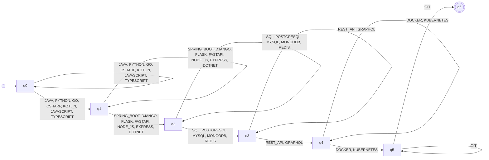

# Automaton BACKEND_DEVELOPER

_Generated by `python -m resumelens.docs_export` from the pyformlang objects._

**Profile:** Backend Developer. Builds server-side services: a backend language and framework, persistent storage, HTTP APIs, containerized deployment and version control. No frontend evidence is required.

## Diagram

## Formal definition

M = (Q, Σ, δ, q0, F)

- **Type**: Nondeterministic finite automaton (NFA)
- **Q** = {q0, q1, q2, q3, q4, q5, q6}
- **Σ** = {JAVA, PYTHON, GO, CSHARP, KOTLIN, JAVASCRIPT, TYPESCRIPT, SPRING_BOOT, DJANGO, FLASK, FASTAPI, NODE_JS, EXPRESS, DOTNET, SQL, POSTGRESQL, MYSQL, MONGODB, REDIS, REST_API, GRAPHQL, DOCKER, KUBERNETES, GIT}
- **q0** = q0
- **F** = {q6}
- **δ** (48 transitions). Pairs that are not in the table go nowhere, so the sequence is rejected.

| state | symbols | δ(state, symbol) |
|---|---|---|
| q0 | JAVA, PYTHON, GO, CSHARP, KOTLIN, JAVASCRIPT, TYPESCRIPT | {q0, q1} |
| q1 | SPRING_BOOT, DJANGO, FLASK, FASTAPI, NODE_JS, EXPRESS, DOTNET | {q1, q2} |
| q2 | SQL, POSTGRESQL, MYSQL, MONGODB, REDIS | {q2, q3} |
| q3 | REST_API, GRAPHQL | {q3, q4} |
| q4 | DOCKER, KUBERNETES | {q4, q5} |
| q5 | GIT | {q5, q6} |

Groups of the pattern (in canonical order):

- q0 → q1: **LANGUAGE** (required) = {JAVA, PYTHON, GO, CSHARP, KOTLIN, JAVASCRIPT, TYPESCRIPT}
- q1 → q2: **FRAMEWORK** (required) = {SPRING_BOOT, DJANGO, FLASK, FASTAPI, NODE_JS, EXPRESS, DOTNET}
- q2 → q3: **DATABASE** (required) = {SQL, POSTGRESQL, MYSQL, MONGODB, REDIS}
- q3 → q4: **API** (required) = {REST_API, GRAPHQL}
- q4 → q5: **CONTAINERS** (required) = {DOCKER, KUBERNETES}
- q5 → q6: **VERSION_CONTROL** (required) = {GIT}
