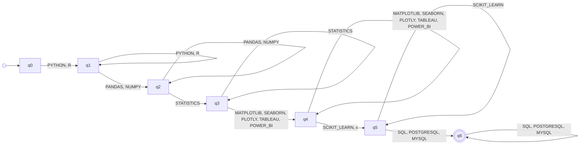

# Automaton DATA_SCIENTIST

_Generated by `python -m resumelens.docs_export` from the pyformlang objects._

**Profile:** Data Scientist. Analyzes data with statistical methods and communicates findings through visualizations. Machine-learning libraries are welcome but not mandatory.

## Diagram

## Formal definition

M = (Q, Σ, δ, q0, F)

- **Type**: Nondeterministic finite automaton with ε-transitions (ε-NFA)
- **Q** = {q0, q1, q2, q3, q4, q5, q6}
- **Σ** = {PYTHON, R, PANDAS, NUMPY, STATISTICS, MATPLOTLIB, SEABORN, PLOTLY, TABLEAU, POWER_BI, SCIKIT_LEARN, SQL, POSTGRESQL, MYSQL}
- **q0** = q0
- **F** = {q6}
- **δ** (29 transitions). Pairs that are not in the table go nowhere, so the sequence is rejected.

| state | symbols | δ(state, symbol) |
|---|---|---|
| q0 | PYTHON, R | {q1} |
| q1 | PYTHON, R | {q1} |
| q1 | PANDAS, NUMPY | {q2} |
| q2 | PANDAS, NUMPY | {q2} |
| q2 | STATISTICS | {q3} |
| q3 | STATISTICS | {q3} |
| q3 | MATPLOTLIB, SEABORN, PLOTLY, TABLEAU, POWER_BI | {q4} |
| q4 | MATPLOTLIB, SEABORN, PLOTLY, TABLEAU, POWER_BI | {q4} |
| q4 | SCIKIT_LEARN, ε | {q5} |
| q5 | SCIKIT_LEARN | {q5} |
| q5 | SQL, POSTGRESQL, MYSQL | {q6} |
| q6 | SQL, POSTGRESQL, MYSQL | {q6} |

Groups of the pattern (in canonical order):

- q0 → q1: **LANGUAGE** (required) = {PYTHON, R}
- q1 → q2: **DATA_LIBRARY** (required) = {PANDAS, NUMPY}
- q2 → q3: **STATISTICS** (required) = {STATISTICS}
- q3 → q4: **VISUALIZATION** (required) = {MATPLOTLIB, SEABORN, PLOTLY, TABLEAU, POWER_BI}
- q4 → q5: **ML_LIBRARY** (optional) = {SCIKIT_LEARN}
- q5 → q6: **DATABASE** (required) = {SQL, POSTGRESQL, MYSQL}
