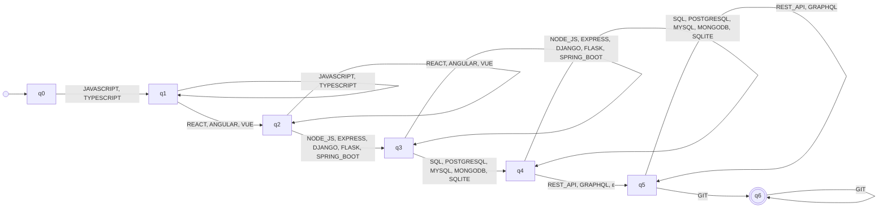

# Automaton FULL_STACK_DEVELOPER

_Generated by `python -m resumelens.docs_export` from the pyformlang objects._

**Profile:** Full Stack Developer. Works on client-side and server-side components: user interfaces, backend services, APIs, database access and version control.

## Diagram

## Formal definition

M = (Q, Σ, δ, q0, F)

- **Type**: Nondeterministic finite automaton with ε-transitions (ε-NFA)
- **Q** = {q0, q1, q2, q3, q4, q5, q6}
- **Σ** = {JAVASCRIPT, TYPESCRIPT, REACT, ANGULAR, VUE, NODE_JS, EXPRESS, DJANGO, FLASK, SPRING_BOOT, SQL, POSTGRESQL, MYSQL, MONGODB, SQLITE, REST_API, GRAPHQL, GIT}
- **q0** = q0
- **F** = {q6}
- **δ** (37 transitions). Pairs that are not in the table go nowhere, so the sequence is rejected.

| state | symbols | δ(state, symbol) |
|---|---|---|
| q0 | JAVASCRIPT, TYPESCRIPT | {q1} |
| q1 | JAVASCRIPT, TYPESCRIPT | {q1} |
| q1 | REACT, ANGULAR, VUE | {q2} |
| q2 | REACT, ANGULAR, VUE | {q2} |
| q2 | NODE_JS, EXPRESS, DJANGO, FLASK, SPRING_BOOT | {q3} |
| q3 | NODE_JS, EXPRESS, DJANGO, FLASK, SPRING_BOOT | {q3} |
| q3 | SQL, POSTGRESQL, MYSQL, MONGODB, SQLITE | {q4} |
| q4 | SQL, POSTGRESQL, MYSQL, MONGODB, SQLITE | {q4} |
| q4 | REST_API, GRAPHQL, ε | {q5} |
| q5 | REST_API, GRAPHQL | {q5} |
| q5 | GIT | {q6} |
| q6 | GIT | {q6} |

Groups of the pattern (in canonical order):

- q0 → q1: **FRONTEND_LANGUAGE** (required) = {JAVASCRIPT, TYPESCRIPT}
- q1 → q2: **FRONTEND_FRAMEWORK** (required) = {REACT, ANGULAR, VUE}
- q2 → q3: **BACKEND** (required) = {NODE_JS, EXPRESS, DJANGO, FLASK, SPRING_BOOT}
- q3 → q4: **DATABASE** (required) = {SQL, POSTGRESQL, MYSQL, MONGODB, SQLITE}
- q4 → q5: **API** (optional) = {REST_API, GRAPHQL}
- q5 → q6: **VERSION_CONTROL** (required) = {GIT}
