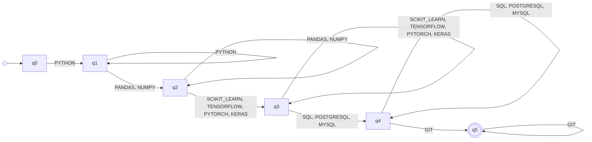

# Automaton MACHINE_LEARNING_ENGINEER

_Generated by `python -m resumelens.docs_export` from the pyformlang objects._

**Profile:** Machine Learning Engineer. Combines software development, data processing and machine-learning frameworks to build learning-based systems.

## Diagram

## Formal definition

M = (Q, Σ, δ, q0, F)

- **Type**: Deterministic finite automaton (DFA)
- **Q** = {q0, q1, q2, q3, q4, q5}
- **Σ** = {PYTHON, PANDAS, NUMPY, SCIKIT_LEARN, TENSORFLOW, PYTORCH, KERAS, SQL, POSTGRESQL, MYSQL, GIT}
- **q0** = q0
- **F** = {q5}
- **δ** (22 transitions). Pairs that are not in the table go nowhere, so the sequence is rejected.

| state | symbols | δ(state, symbol) |
|---|---|---|
| q0 | PYTHON | {q1} |
| q1 | PYTHON | {q1} |
| q1 | PANDAS, NUMPY | {q2} |
| q2 | PANDAS, NUMPY | {q2} |
| q2 | SCIKIT_LEARN, TENSORFLOW, PYTORCH, KERAS | {q3} |
| q3 | SCIKIT_LEARN, TENSORFLOW, PYTORCH, KERAS | {q3} |
| q3 | SQL, POSTGRESQL, MYSQL | {q4} |
| q4 | SQL, POSTGRESQL, MYSQL | {q4} |
| q4 | GIT | {q5} |
| q5 | GIT | {q5} |

Groups of the pattern (in canonical order):

- q0 → q1: **LANGUAGE** (required) = {PYTHON}
- q1 → q2: **DATA_LIBRARY** (required) = {PANDAS, NUMPY}
- q2 → q3: **ML_FRAMEWORK** (required) = {SCIKIT_LEARN, TENSORFLOW, PYTORCH, KERAS}
- q3 → q4: **DATABASE** (required) = {SQL, POSTGRESQL, MYSQL}
- q4 → q5: **VERSION_CONTROL** (required) = {GIT}
